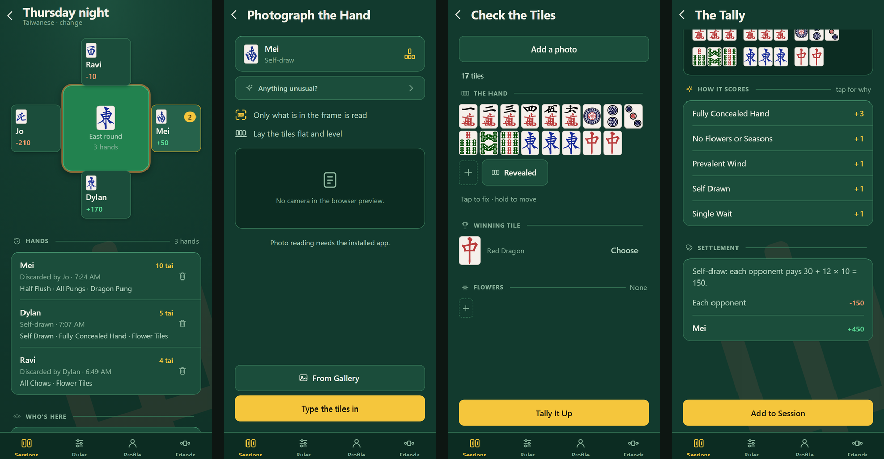
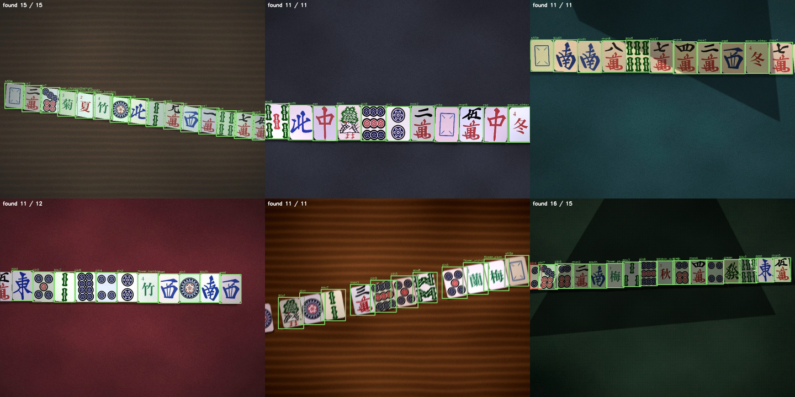

# Mahjong Scorer

A mobile app that reads a winning mahjong hand from a photo and scores it. Two small custom PyTorch models find and identify the tiles on the phone, a geometry pass puts them in reading order, and a TypeScript rules engine scores the hand under Taiwanese, Hong Kong, Japanese Riichi or Chinese Official (MCR) rules, or a custom ruleset. It also keeps score for a four-player session.

The app is published under the name Tile Tally.



## Results

Measured on 568 held-out real photos (7,568 tiles) that neither model saw during training or validation. Source: `ml/runs/four/evaluation-jonchan.json`, details in [docs/model-card.md](docs/model-card.md).

| Metric | Value |
|---|---|
| Per-tile accuracy, end to end | 91.1% |
| Whole hand read with no errors | 66.5% |
| Detection AP@0.5 | 0.915 |
| Classifier top-1 / top-3 on detected tiles | 98.8% / 99.6% |
| Latency, median / p95 (single-threaded CPU, ONNX Runtime) | 18.3 ms / 25.8 ms |
| Model size (detector + classifier, ONNX) | 1.17 MB + 0.64 MB |

Training mixed procedurally rendered scenes with about 98K real tile instances from three CC BY 4.0 datasets on Roboflow Universe. Fine-tuning on real photos alone reached 52% whole-hand accuracy on real photos but dropped to 9% on synthetic ones; training on both sources kept both.



## How it works

```
photo -> detector (320x320, anchor-free, 1 class) -> tile boxes
      -> classifier (48x64 crop per box, 42 classes) -> tile names
      -> ordering (table rotation, rows, meld vs concealed split) -> ordered hand
      -> rules engine (decomposition, patterns, payouts) -> score and settlement
```

- **Detector:** separable-conv backbone with a centre-point head. Peak finding and box decoding are part of the exported ONNX graph, so the app gets boxes and scores directly.
- **Classifier:** four separable-conv stages, global pool, linear layer, run on full-resolution crops.
- **Ordering:** estimates the table's rotation from the tiles, groups them into rows and splits melds from the concealed hand by spacing.
- **Scoring:** rulesets are data. Each pattern has a value and an on/off switch, and any ruleset can be cloned and edited. Every matched pattern is listed with its value.
- **Accounts (optional):** Supabase auth and Postgres with row-level security for sync, friends and shared sessions. Without Supabase configured the app runs fully offline.

`mobile/src/tiles/tileset.ts` is generated from `ml/src/tileset.py` so the class order cannot drift between training and the app, and `mobile/src/vision/__tests__/parity.json` checks the app's preprocessing against the training pipeline.

More detail: [docs/architecture.md](docs/architecture.md), [docs/rulesets.md](docs/rulesets.md).

## Tech stack

- **ML:** Python, PyTorch, OpenCV, ONNX, ONNX Runtime
- **App:** TypeScript, React Native, Expo (SDK 57, Expo Router), onnxruntime-react-native, Jest
- **Backend:** Supabase (Postgres, row-level security, auth)

## Running it

Requires Node.js. The camera and on-device inference need a development build; the web preview falls back to typing the tiles in.

```bash
cd mobile
npm install
npm test              # Jest: scoring, ordering, sync, preprocessing parity
npm run typecheck
npm run web           # browser preview, manual tile entry
```

On a phone, make a development build with EAS and start the dev server. See [EAS.md](EAS.md).

```bash
eas build --profile development --platform android
npm start
```

### Accounts (optional)

1. Create a Supabase project and apply `supabase/migrations/` in order (`supabase db push` or the SQL editor).
2. Copy `mobile/.env.example` to `mobile/.env` and set the project URL and publishable key.
3. Check the row-level security policies against the project:

```bash
SUPABASE_URL=... SUPABASE_KEY=... node supabase/verify-rls.mjs
SUPABASE_URL=... SUPABASE_KEY=... node supabase/verify-sync.mjs
```

### Training the models

The exported models are committed in `mobile/assets/models/`. PyTorch checkpoints and datasets are not.

```bash
cd ml
pip install -r requirements.txt
```

The full pipeline (render tile faces, generate synthetic scenes, fetch the real datasets, build crops, train, evaluate, export) is in the Reproducing section of [docs/model-card.md](docs/model-card.md). Fetching the real datasets needs `ROBOFLOW_API_KEY` (see `.env.example`). To add photos of your own tile set, see [docs/real-photos.md](docs/real-photos.md).

## Project layout

```
ml/src/            tile rendering, synthetic scenes, dataset import, training, evaluation, ONNX export
ml/runs/           training histories and evaluation results
mobile/src/vision/ preprocessing, inference, tile ordering
mobile/src/scoring/ rules engine and the six built-in rulesets
mobile/src/store/  sessions, stats, sync engine
mobile/src/app/    screens (Expo Router)
supabase/          migrations and RLS verification scripts
site/              privacy and terms pages
docs/              architecture, model card, rulesets
```

## Status and limitations

Working app with 346 passing tests. The models know 42 tile classes and have no "unknown" class; flowers and seasons are the weakest classes, and an unusual tile design is out of distribution. See the limitations section of the model card.

## Credits

Tile faces come from [FluffyStuff/riichi-mahjong-tiles](https://github.com/FluffyStuff/riichi-mahjong-tiles) (CC0). Real training photos come from the Roboflow Universe datasets listed in the model card (CC BY 4.0).

## License

Released under the MIT License. See [LICENSE](LICENSE).
